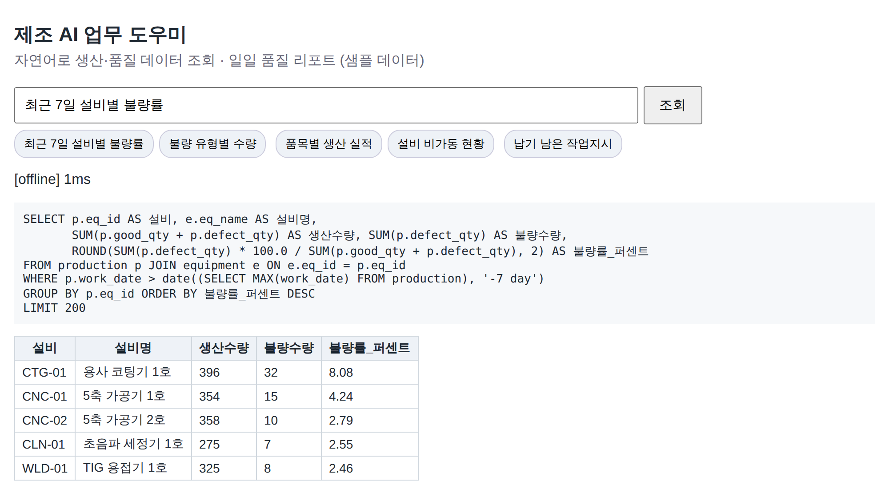
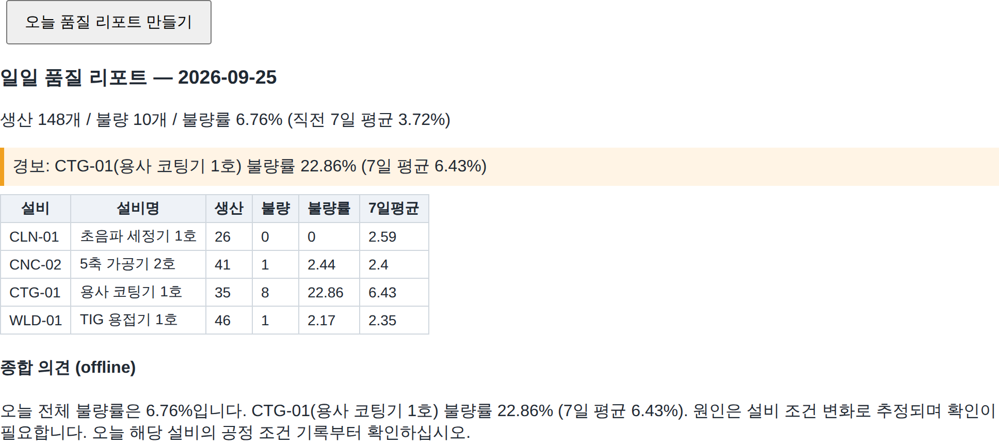

# factory-ai-assistant — 제조 현장 AI 업무 도우미 (포트폴리오 데모)

반도체·디스플레이 장비 부품 공장을 가정한 **샘플 데이터** 위에서 두 가지를 보여 주는 작은 프로그램입니다.

1. **자연어 데이터 조회** — "최근 7일 설비별 불량률 알려줘" → LLM이 SQL 작성 → 안전 검사 → 읽기 전용 실행 → 표
2. **일일 품질 리포트 자동 작성** — 숫자는 코드가 집계, LLM은 의견 문장만 작성 → Markdown + Excel 저장

> 실제 회사·고객 데이터는 사용하지 않았습니다. 모든 데이터는 `fa/seed.py`가 만든 가상 데이터입니다.
> 이 저장소는 AI 개발 도구(Claude)의 도움을 받아 작성했으며, 모든 코드는 직접 검토·실행·테스트했습니다.

## 화면





## 왜 이렇게 만들었나 (설계 원칙)

| 원칙 | 구현 |
|---|---|
| AI가 만든 SQL은 믿지 않는다 | 1겹: 문자열 검사(SELECT 한 문장, 금지어, 허용 테이블, LIMIT 강제) · 2겹: 읽기 전용 연결 + SQLite authorizer로 DB 엔진이 쓰기를 거부 |
| 숫자는 코드가, 문장은 AI가 | 리포트 수치는 SQL 집계. LLM에는 집계값만 전달하고, 답변 속 숫자가 집계표에 없으면 "확인 필요" 표시 |
| 외부로 나가는 데이터 최소화 | LLM에는 테이블 구조와 집계 숫자만 전송. 원본 행 데이터는 보내지 않음 |
| 외부 AI가 막혀도 업무는 돈다 | API 키가 없으면 오프라인(규칙 기반) 모드로 자주 쓰는 질문 5종 처리 |
| 누가 무엇을 물었는지 남긴다 | 모든 질문·SQL·결과 건수·오류를 `logs/audit.jsonl`에 기록 |
| 현업이 쓰는 형식으로 | 리포트를 Excel로도 저장, 경보 설비 행은 붉게 표시 |

## 실행

```bash
python3 -m venv .venv && source .venv/bin/activate
pip install -r requirements.txt

python -m fa init                                  # 샘플 DB 생성
python -m fa ask "최근 7일 설비별 불량률 알려줘"      # 자연어 조회
python -m fa report                                # 일일 품질 리포트 (out/ 폴더에 md, xlsx)
python -m fa serve                                 # 웹 화면 http://127.0.0.1:8090
pytest -q                                          # 테스트
```

Claude API를 쓰려면 `export ANTHROPIC_API_KEY=...` 후 실행합니다(모델은 `FA_MODEL`로 지정).
키가 없으면 자동으로 오프라인 모드가 됩니다. `--llm offline`으로 강제할 수 있습니다.

오프라인 모드에서 답하는 질문: 설비별 불량률 · 불량 유형 · 품목별 생산 · 비가동 · 납기

## 구조

```
fa/seed.py       샘플 DB(품목·설비·작업지시·생산실적·불량·비가동) 생성. 마지막 3일 코팅기 불량 급증을 일부러 심어 둠
fa/llm.py        Claude API / 오프라인 규칙 기반 LLM, 프롬프트
fa/sql_guard.py  SQL 안전장치(2겹)
fa/ask.py        질문 → SQL → 결과, 감사 로그
fa/report.py     일일 품질 리포트: 집계, 경보, LLM 의견, 숫자 검증, Excel
fa/web.py        FastAPI 웹 화면
tests/           테스트 23개 (안전장치 우회 시도, 악성 LLM 응답, 수치 일치, 숫자 검증 등)
```

## 실제 도입 시 바꿀 점

- SQLite 샘플 DB → ERP/MES DB의 **읽기 전용 계정 + 조회용 뷰**로 연결 (원장 테이블 직접 노출 금지)
- 사내 표준 용어(품목코드 체계, 불량 코드)를 스키마 설명에 반영해 SQL 정확도 향상
- 질문 로그를 주기적으로 검토해 자주 틀리는 질문을 오프라인 규칙·뷰로 승격
- 개인정보·단가 등 민감 컬럼은 뷰에서 제외

## 한계 (솔직하게)

- 데모 데이터는 작고 단순합니다. 실제 ERP 스키마는 훨씬 복잡합니다.
- 문자열 기반 SQL 검사는 완벽하지 않습니다. 그래서 DB 권한 제한을 두 번째 겹으로 둡니다.
- 오프라인 모드는 정해진 질문만 처리합니다.
- Claude 연결부는 공식 SDK 호출만 구현했고, 자동 테스트는 오프라인 모드로 수행합니다.
